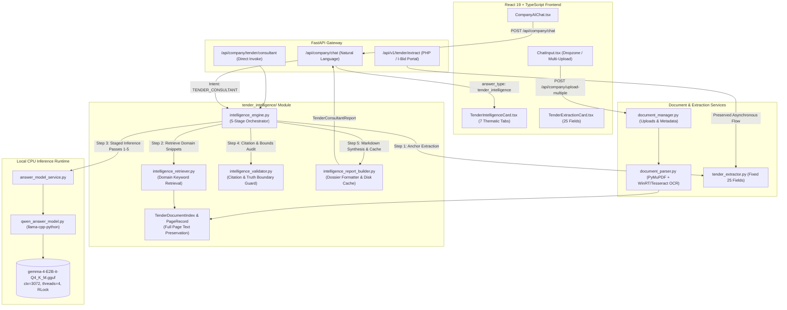

# MYGPT — AI Tender Consultant: Technical Architecture Document
**Component Specifications, Data Flows, and Staged Local Inference Architecture**

---

## 1. System Overview & Core Philosophy

**MYGPT — AI Tender Consultant** transforms MYGPT into an autonomous, professional-grade tender evaluation and bid strategy advisory engine. Unlike traditional data-extraction tools that merely scrape key-value pairs (e.g. basic 25-field NIT extraction), the AI Tender Consultant conducts an end-to-end evaluation of an entire tender document across 11 consultant dimensions.

### Core Tenets
1. **Strict Local Evidence Grounding**: The engine operates under a hard truth boundary. It does not perform web searches, call external APIs, query pricing books, or invent unstated OEM brands.
2. **Deterministic-LLM Hybrid Pipeline**: Deterministic vector extraction (`PyMuPDF`) and in-memory inverted term indexing (`TenderDocumentIndex`) provide targeted page snippets to the local `Gemma 4 E2B` instruction model.
3. **Staged Thematic Passes for Context Budgeting**: To prevent context truncation within Gemma's 3,072-token context window (`n_ctx=3072`), the tender evaluation is split into 5 focused thematic passes.
4. **Non-Breaking Modularity**: The existing 25-field extraction engine, the asynchronous I-Bid portal API (`/api/v1/tender/*`), and the general company AI chat remain completely preserved.

---

## 2. High-Level Architecture Diagram



---

## 3. The 11 Consultant Evaluation Dimensions

The AI Tender Consultant analyzes uploaded tenders across 11 comprehensive dimensions defined in `intelligence_schema.py`:

```
┌─────────────────────────────────────────────────────────────────────────────┐
│                    MYGPT AI TENDER CONSULTANT DOSSIER                       │
├─────────────────────────────────────────────────────────────────────────────┤
│ 1. Tender Overview               │ Authority, Title, Ref No, EMD, Deadlines │
│ 2. Bidder Eligibility & PQ       │ Turnover, Similar Work, Certs, MAF, JV   │
│ 3. Technical Scope Analysis      │ Deliverables, Testing, SLA, Training     │
│ 4. Technical Specifications      │ Item-by-item parameters, quantities, BIS │
│ 5. OEM & Product Requirements    │ Mandatory MAF, proprietary brands, specs │
│ 6. Item-Wise Compliance Matrix   │ Requirement vs Spec vs Assessment table  │
│ 7. Commercial & Financial        │ Payment milestones, PBG, Retention, LD   │
│ 8. Contractual & Legal Clauses   │ Indemnity, Termination, Dispute, Force M │
│ 9. Risk & Contradiction Analysis │ Critical, High, Medium, Low Risk Matrix  │
│ 10. Bid Strategy & Advice        │ Proceed / Caution / Reconsider verdict   │
│ 11. Final Action Roadmap         │ Step-by-step submission checklist & refs │
└─────────────────────────────────────────────────────────────────────────────┘
```

---

## 4. Staged Multi-Pass Inference Strategy

Because Gemma 4 E2B is configured with `n_ctx=3072` tokens to run efficiently on an Intel Core i7 CPU with 4 threads, feeding a 50–100 page tender document in one prompt will result in context overflow. The engine breaks the evaluation into 5 sequential stages:

```
Total Model Context Budget: 3,072 Tokens
├── System Instructions: ~150 tokens (Strict Truth Boundary)
├── Input Anchor Facts: ~180 tokens (Extracted verified parameters)
├── Domain-Guided Page Excerpts: ~1,500 - 1,800 tokens (Retrieved via inverted index)
└── Output Generation Budget: ~600 - 800 tokens (Structured compact JSON)
```

### Staging Breakdown

| Stage | Target Scope | Retrieval Strategy & Keywords | Model Prompt & Output |
| :--- | :--- | :--- | :--- |
| **Stage 1: Overview & Scope** | Dimension 1 (Overview) & Dimension 3 (Scope) | High-relevance pages for: `notice inviting`, `e-tender`, `scope of work`, `deliverables`, `delivery period`, `contract period`, `emd`. | Generates `TenderOverview` and `TechnicalScopeAnalysis` with exact page citations. |
| **Stage 2: Eligibility & PQ** | Dimension 2 (Bidder Eligibility & PQ) | High-relevance pages for: `eligibility criteria`, `annual turnover`, `similar work`, `ca certificate`, `registration`, `gst`, `pan`, `maf`, `consortium`. | Generates `EligibilityAnalysis` with mandatory document requirements and disqualification effects. |
| **Stage 3: Specs, OEM & Compliance** | Dimension 4 (Specs), Dimension 5 (OEM), Dimension 6 (Compliance) | High-relevance pages for: `technical specification`, `boq`, `oem authorization`, `manufacturer authorization`, `brand`, `model`, `standards`. | Generates `TechnicalSpecificationAnalysis`, `OEMRequirementAnalysis`, and the complete `ItemWiseComplianceMatrix`. |
| **Stage 4: Commercial & Legal** | Dimension 7 (Commercial) & Dimension 8 (Legal) | High-relevance pages for: `payment terms`, `milestone`, `pbg`, `performance bank guarantee`, `security deposit`, `liquidated damages`, `penalty`, `termination`. | Generates `CommercialFinancialAnalysis` and `ContractualLegalAnalysis` with financial liability analysis. |
| **Stage 5: Risks & Roadmap** | Dimension 9 (Risks), Dimension 10 (Strategy), Dimension 11 (Roadmap) | High-relevance pages for: `rejection`, `disqualification`, `penalty`, `deviation`, `contradiction`, combined with findings from Stages 1–4. | Generates `RiskContradictionAnalysis`, strategic verdict (`Proceed` / `Caution` / `Reconsider`), and actionable checklist `ActionRoadmap`. |

---

## 5. Truth Boundary & Anti-Hallucination Framework

Every claim produced by the AI Tender Consultant is audited by `intelligence_validator.py` and tagged with mandatory classification markers:

```
[ TENDER REQUIREMENT ]          -> Exact rule or parameter specified in tender text
[ CONSULTANT RECOMMENDATION ]   -> Strategic advisory insight from AI consultant
[ ASSUMPTION / CAVEAT ]         -> Operational assumption or financial risk notice
[ NOT SPECIFIED IN TENDER ]     -> Information absent from document (never guessed)
[ NEEDS CLARIFICATION ]        -> Ambiguity requiring formal pre-bid query submission
```

### Programmatic Guardrails in `intelligence_validator.py`
1. **Page Reference Boundary Checking**: Every cited page number is validated against `1 <= page_number <= total_pages`. Out-of-bounds page citations are automatically clamped and flagged in `verification_notes`.
2. **Recommendation Normalization**: Multi-word recommendation enums (`Proceed with caution`, `Requires clarification before proceeding`, `High risk / reconsider participation`, `Proceed`) are parsed using descending length ordering to avoid substring collision.
3. **Risk Level Normalization**: Risk items are validated into strict `Critical`, `High`, `Medium`, `Low` tiers.

---

## 6. Storage & Caching Architecture

1. **Document Storage**: Uploaded files reside at `data/uploads/<uuid>.<ext>` or `data/documents/<uuid>.<ext>` with metadata preserved in `documents_metadata.json`.
2. **Page Record Inversion**: Parsed pages are cached in memory as `PageRecord` objects within `TenderDocumentIndex`.
3. **Consultant Report Disk Cache**:
   - Location: `data/cache/tender_intelligence/{bundle_signature}_consultant_v1.json`
   - Cache Key: SHA-256 hash of document contents + analyzer version.
   - Cache Hit Latency: **< 50 milliseconds** (bypasses LLM inference entirely when evaluating previously parsed tender documents).

---

## 7. Frontend Component Architecture

```
CompanyAIChat.tsx
 ├── Document Quick Action Bar
 │    ├── "AI Tender Consultant Report" (Triggers evaluation)
 │    └── "25-Field Extraction" (Triggers fixed extractor)
 └── ChatMessageItem.tsx
      ├── isTenderIntelligence === true
      │    └── TenderIntelligenceCard.tsx
      │         ├── Executive Header (Title, Authority, Verdict Badge)
      │         ├── Metrics Ribbon (Value, EMD, Deadline, Critical Risks)
      │         ├── 7 Thematic Navigation Tabs
      │         ├── Copy Markdown Dossier Button
      │         └── Audit & Verification Status Footer
      └── isTenderExtraction === true
           └── TenderExtractionCard.tsx (Preserved 25-Field Accordion)
```

---

## 8. API Specifications

### `POST /api/company/tender/consultant`
Generates comprehensive consultant report directly.
- **Request Body (JSON)**:
  ```json
  {
    "document_ids": ["doc_uuid_1"],
    "session_id": "company_session",
    "force_refresh": false
  }
  ```
- **Response (JSON)**:
  ```json
  {
    "success": true,
    "tender_intelligence": { ...TenderConsultantReport... },
    "executive_summary": "# 📋 Tender Consultant Executive Briefing...",
    "full_report_markdown": "# 📑 MYGPT AI Tender Consultant — Full Evaluation..."
  }
  ```

### `POST /api/company/chat`
Conversational chat interface handler.
- If user query matches consultant triggers (e.g., *"Evaluate this tender like a consultant"*, *"Bid strategy"*, *"Risk analysis"*), returns `answer_type="tender_intelligence"`.
- If user asks a follow-up question regarding the analyzed tender, routes to `tender_intelligence_engine.answer_consultant_question()` grounding the answer in both the original pages and the consultant dossier.

